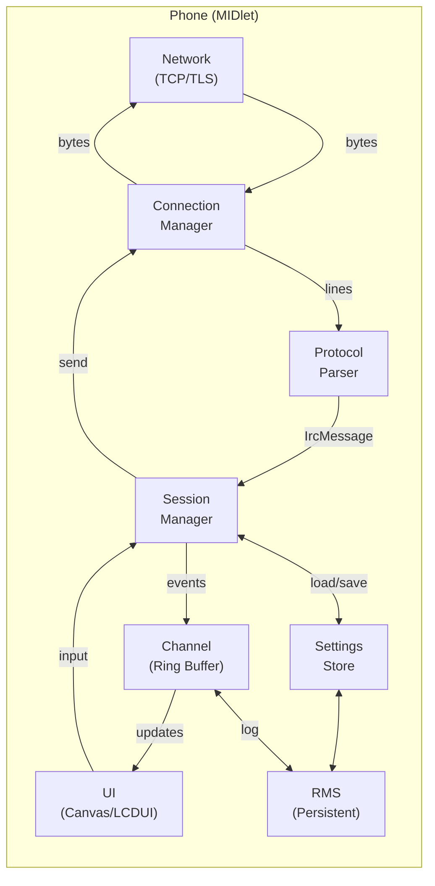
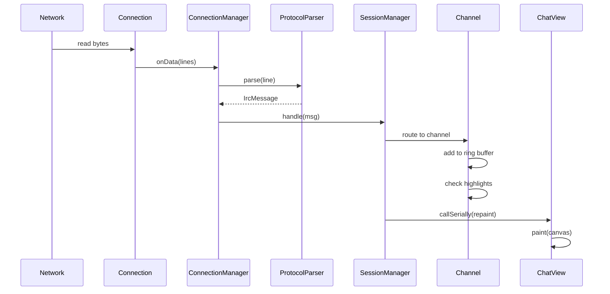
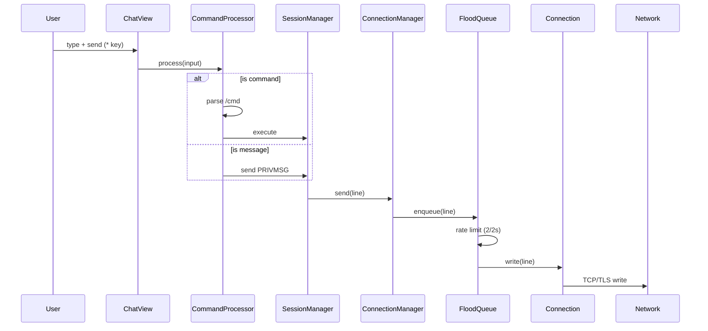
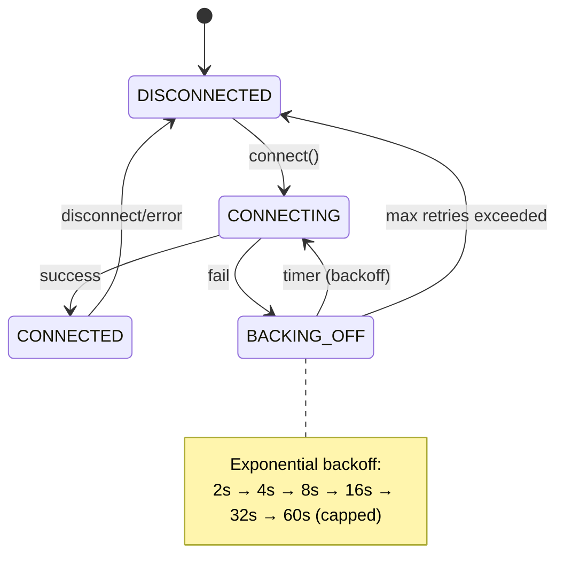

# Architecture Overview

Deep dive into Chatterbox's code structure, design patterns, and module responsibilities.

---

## Project Structure

```
chatterbox/
├── midlet/
│   └── src/com/chatterbox/
│       ├── proto/          # Protocol layer (pure Java, no MIDP deps)
│       │   ├── ProtocolParser.java
│       │   ├── IrcMessage.java
│       │   ├── Ctcp.java
│       │   └── CaseMapping.java
│       ├── core/           # Session state, events, commands
│       │   ├── Session.java
│       │   ├── SessionManager.java
│       │   ├── Channel.java
│       │   ├── UserEntry.java
│       │   ├── MessageHistory.java
│       │   ├── HighlightRules.java
│       │   ├── IgnoreList.java
│       │   ├── AutoAway.java
│       │   ├── ServiceIdentify.java
│       │   ├── WhoisCache.java
│       │   ├── CommandProcessor.java
│       │   └── IrcCase.java
│       ├── net/            # Connection, flood control, reconnect
│       │   ├── Connection.java
│       │   ├── ConnectionManager.java
│       │   ├── SocketFactory.java
│       │   ├── FloodQueue.java
│       │   └── ConnectionConfig.java
│       ├── rms/            # Persistent storage (RecordStore)
│       │   ├── ProfileStore.java
│       │   ├── SettingsStore.java
│       │   ├── LogStore.java
│       │   └── IgnoreStore.java
│       └── ui/             # LCDUI screens + custom Canvas
│           ├── ChatterboxMIDlet.java
│           ├── ChatView.java
│           ├── ChatCanvas.java
│           ├── SettingsScreen.java
│           ├── ServiceScreen.java
│           ├── HighlightScreen.java
│           ├── IgnoreScreen.java
│           ├── QuickConnect.java
│           ├── LogViewer.java
│           └── UrlHandler.java
├── test/
│   ├── shim/               # Minimal JUnit 3 shim
│   └── src/com/chatterbox/test/
│       ├── ProtocolParserTest.java
│       ├── CoreTest.java
│       └── SessionTest.java
├── gateway/
│   ├── server.py           # Python asyncio TLS relay
│   ├── Dockerfile
│   └── deploy/
└── stub/                   # MIDP/CLDC API stubs for desktop compile
```

---

## Design Principles

| Principle | Implementation |
|-----------|----------------|
| **Separation of concerns** | Protocol (proto) ≠ State (core) ≠ Network (net) ≠ UI (ui) ≠ Storage (rms) |
| **Testability** | Protocol & core have zero MIDP dependencies; run on desktop JDK |
| **Resource constraints** | Ring buffers, bounded queues, lazy loading, ProGuard optimization |
| **Robustness** | All I/O in try/catch, malformed input never crashes, graceful degradation |
| **Platform idioms** | LCDUI for forms, Canvas for chat (performance), RMS for persistence |

---

## Data Flow

### System Overview (Mermaid)



### Message Flow (Inbound)



### Message Flow (Outbound)



### Message Flow (Inbound)
1. **Network** → `Connection.run()` reads bytes
2. **Connection** → `ConnectionManager.onData()` receives lines
3. **ProtocolParser.parse()** → `IrcMessage` objects
4. **SessionManager.handle()** → Routes to `Channel`/`Session`
5. **Channel** → Adds to ring buffer, checks highlights
6. **UI** → `ChatView.repaint()` triggered via `Display.callSerially()`

### Message Flow (Outbound)
1. **User input** → `ChatView.commandAction()`
2. **CommandProcessor** → Parses `/cmd` or treats as message
3. **SessionManager.send()** → `ConnectionManager.send()`
4. **FloodQueue** → Queues, rate-limits (2 msg/2s)
5. **Connection** → Writes to socket

---

## Module Details

### `proto/` — Protocol Layer (Pure Java)

**Zero MIDP dependencies** — runs on desktop JDK for unit tests.

| Class | Responsibility |
|-------|----------------|
| `ProtocolParser` | Parses raw IRC lines → `IrcMessage` (RFC 2812 + CTCP) |
| `IrcMessage` | Immutable parsed message: prefix, command, params, tags |
| `Ctcp` | CTCP encoding/decoding (ACTION, VERSION, PING, etc.) |
| `CaseMapping` | RFC 1459 / RFC 2812 case mapping (ascii-only) |

**Key parsing features:**
- Handles malformed lines gracefully (never throws)
- Supports message tags (@batch, @msgid — IRCv3)
- CTCP extraction from PRIVMSG/NOTICE
- Numeric command mapping (001, 353, 366, 433, etc.)

### `core/` — Session State & Logic

| Class | Responsibility |
|-------|----------------|
| `Session` | Single server connection state: nick, channels, capabilities |
| `SessionManager` | Manages sessions, routes events, command processing |
| `Channel` | Per-channel state: ring buffer, nick list, topic, modes |
| `UserEntry` | Nick + modes + host + away + account + realname |
| `MessageHistory` | Ring buffer (circular array) with scroll position |
| `HighlightRules` | Pattern matching for highlights (regex + word boundary) |
| `IgnoreList` | Hostmask patterns with wildcard support |
| `AutoAway` | Auto-away on background, back on foreground |
| `ServiceIdentify` | NickServ/ChanServ identification |
| `WhoisCache` | Cached whois results with TTL |
| `CommandProcessor` | Parses `/commands`, dispatches to handlers |
| `IrcCase` | Case-insensitive comparison per RFC 1459 |

**Channel Ring Buffer:**
```java
// MessageHistory.java
private final String[] buffer = new String[capacity];
private int head = 0;
private int size = 0;
private int scrollOffset = 0;  // 0 = at bottom (live)
```
- O(1) append, O(1) random access for rendering
- Scroll offset preserved across channel switches

### `net/` — Network Layer

| Class | Responsibility |
|-------|----------------|
| `Connection` | Single socket lifecycle: connect, read loop, write queue |
| `ConnectionManager` | Multi-connection orchestration, reconnect logic |
| `SocketFactory` | Creates `socket://` or `ssl://` connections |
| `FloodQueue` | Token bucket: 2 messages per 2 seconds, burst 4 |
| `ConnectionConfig` | Immutable config: host, port, TLS, gateway, credentials |

**Reconnect State Machine:**



- Exponential backoff: 2s, 4s, 8s, 16s, 32s, 60s (capped)
- Keepalive: PING every 90s, timeout 300s
- Background/foreground handling via `pauseApp()`/`startApp()`

### `rms/` — Persistent Storage (RecordStore)

| Class | Record Store | Data |
|-------|--------------|------|
| `ProfileStore` | `chatterbox-profile-<name>` | All connection settings |
| `SettingsStore` | `chatterbox-settings` | Global UI prefs, highlights, ignore |
| `LogStore` | `chatterbox-log-<server>` | Persistent scrollback (1000 lines/channel) |
| `IgnoreStore` | `chatterbox-ignore` | Ignore masks |

**RMS Patterns:**
```java
// ProfileStore.save(Profile p)
RecordStore rs = RecordStore.openRecordStore(name, true);
byte[] data = serialize(p);  // DataOutputStream → ByteArrayOutputStream
if (rs.getNumRecords() == 0) rs.addRecord(data, 0, data.length);
else rs.setRecord(1, data, 0, data.length);
rs.closeRecordStore();
```

### `ui/` — User Interface

| Class | Type | Responsibility |
|-------|------|----------------|
| `ChatterboxMIDlet` | MIDlet | App lifecycle, Display access, global state |
| `ChatView` | Canvas | Custom chat rendering, input handling, key events |
| `ChatCanvas` | Canvas | Low-level drawing: text wrap, nick colors, selection |
| `SettingsScreen` | Form | Profile configuration (all tabs) |
| `ServiceScreen` | List | Server/channel list with badges |
| `HighlightScreen` | Form | Highlight rule management |
| `IgnoreScreen` | Form | Ignore list management |
| `QuickConnect` | Form | One-shot connection dialog |
| `LogViewer` | Canvas | Full-screen log browsing |
| `UrlHandler` | — | URL detection, browser launch |

**ChatView Rendering Pipeline:**
```
paint(Graphics g)
  │
  ├─► calculateVisibleLines()     // Based on scrollOffset, font height
  ├─► for each visible line:
  │     ├─► parse: timestamp, nick, message
  │     ├─► measure: string widths, wrap if needed
  │     ├─► draw: background, timestamp, nick (color), message
  │     └─► highlight: yellow bg if highlighted
  └─► drawInputLine()             // Input field at bottom
```

**Nick Colors:** Deterministic hash of nick → 16-color palette (consistent across sessions).

---

## Threading Model

| Thread | Responsibility |
|--------|----------------|
| **Main (MIDlet)** | LCDUI event dispatch, `commandAction()`, `paint()` |
| **Connection I/O** | One per connection: `Connection.run()` blocking read |
| **Timer/Keepalive** | `TimerTask` for PING, reconnect backoff |
| **RMS** | Synchronous on calling thread (fast, small data) |

**Thread Safety:**
- `SessionManager` / `Channel` / `MessageHistory` — **Not thread-safe**
- All mutations from network thread → `Display.callSerially(() → mutate + repaint)`
- `FloodQueue` — Synchronized (producer: UI thread, consumer: network thread)

```java
// Typical pattern in ConnectionManager
Display.getDisplay(midlet).callSerially(() -> {
    session.handleMessage(msg);
    chatView.repaint();
});
```

---

## Memory Profile (Target: < 1 MB Heap)

| Component | Est. Heap |
|-----------|-----------|
| Session + 10 channels × 200 lines | ~200 KB |
| Nick lists (50 nicks × 10 chans) | ~50 KB |
| RMS buffers (serialization) | ~30 KB |
| UI (fonts, images, canvas buffer) | ~100 KB |
| Protocol parser buffers | ~10 KB |
| **Total** | **~400 KB** |

**Optimizations:**
- `String.intern()` for repeated nicks/channels
- Primitive arrays vs. `Vector`/`ArrayList`
- Reuse `StringBuilder` for rendering
- ProGuard: `-optimize` `-obfuscate` `-shrink`

---

## Extension Points

### Adding a Command
1. Add to `CommandProcessor.COMMANDS` map
2. Implement `CommandHandler` functional interface
3. Add help text in `CommandProcessor.getHelp()`

```java
COMMANDS.put("mycmd", (session, args) -> {
    // args[0] = command, args[1..] = parameters
    session.sendRaw("PRIVMSG #chan :Custom command!");
    return true; // consumed
});
```

### Adding a Settings Field
1. Add to `Profile` class + `serialize()`/`deserialize()`
2. Add UI field in `SettingsScreen.createForm()`
3. Handle in `SettingsScreen.load()`/`save()`

### Custom CTCP
```java
// In Ctcp.java
public static final String MY_CTCP = "MYCTCP";

// Handle in SessionManager.handleCtcp()
if (Ctcp.MY_CTCP.equals(ctcpCommand)) {
    sendCtcpReply(target, "MYCTCP", "Custom response");
}
```

---

## Test Architecture

### Test Shim (`test/shim/`)
Minimal JUnit 3 subset — no external JAR:
- `TestCase` — base class with `runTest()`
- `TestRunner` — text UI runner, `TestResult` collection
- `Assert` — `assertTrue`, `assertEquals`, `assertNull`, `fail`

### Test Coverage
| Test Class | Focus |
|------------|-------|
| `ProtocolParserTest` | 42 tests: parsing, numerics, CTCP, edge cases |
| `CoreTest` | 47 tests: commands, case mapping, string utils |
| `SessionTest` | 40 tests: ring buffer, nick list, highlights, modes |

**Running:** `ant test` (desktop JDK, no WTK needed)

---

## Performance Characteristics

| Operation | Complexity | Notes |
|-----------|------------|-------|
| Message append | O(1) | Ring buffer |
| Scroll render | O(lines visible) | ~10-15 lines |
| Nick completion | O(nicks in channel) | Linear scan, < 1ms |
| Highlight check | O(rules × message len) | Rules typically < 10 |
| RMS save | O(data size) | < 5 KB, ~50ms |
| Reconnect backoff | O(1) | TimerTask |

---

## Security Boundaries

| Boundary | Protection |
|----------|------------|
| Network → Parser | No allocation in hot path, bounded buffers |
| Parser → Session | Validated `IrcMessage`, no raw strings |
| Session → UI | `callSerially()` — no cross-thread UI access |
| RMS → App | Private record stores, no external access |
| Gateway → IRC | TLS 1.2+, cert verification (configurable) |

---

## Related Docs

- [Development](development.md) — Building, debugging, contributing
- [Building](building.md) — Build system details
- [Configuration](configuration.md) — Settings architecture
- [Gateway](gateway.md) — Gateway server architecture
- [Security](security.md) — Threat model