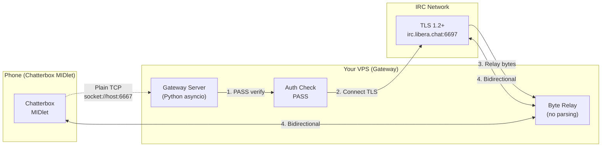
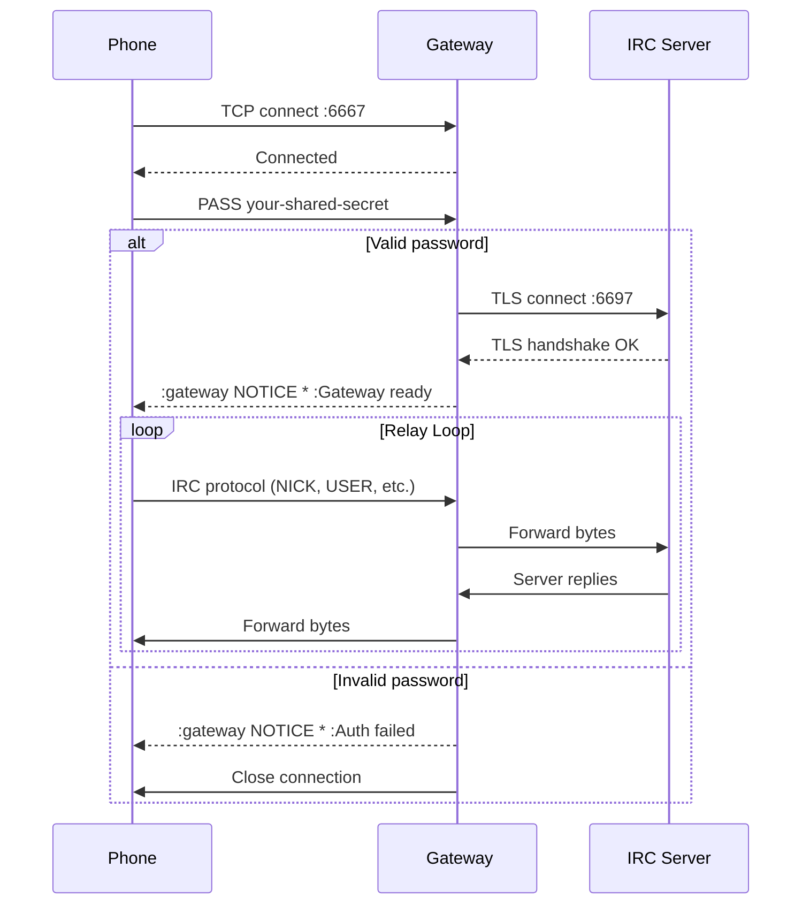

# Gateway Server (TLS Relay)

The Chatterbox gateway is a Python asyncio TLS relay that allows the MIDlet to connect via plain TCP while the gateway handles TLS to the IRC network. This avoids device-side certificate issues.

---

## ️ Architecture

### System Overview (Mermaid)



### Protocol Sequence (Mermaid)



### Deployment Options (Mermaid)

```mermaid
graph TD
    subgraph Docker[" Docker"]
        D1[docker build]
        D2[docker run -d\n-p 6667:6667\n-e GATEWAY_PASSWORD=...]
    end

    subgraph Systemd["️ Bare Metal (systemd)"]
        S1[Create gateway user]
        S2[Setup venv + server.py]
        S3[/etc/chatterbox-gateway.env]
        S4[Install .service unit]
        S5[systemctl enable --now]
    end

    subgraph K8s["️ Kubernetes (Advanced)"]
        K1[Deployment: 2+ replicas]
        K2[Service: LoadBalancer]
        K3[ConfigMap: env vars]
        K4[Secret: GATEWAY_PASSWORD]
        K5[Ingress: TCP/UDP]
    end

    Docker -->|Simple, portable| Prod[Production]
    Systemd -->|Full control| Prod
    K8s -->|Scale, HA| Prod
```

---

## Quick Start: Docker

### Build Image
```bash
cd gateway
docker build -t chatterbox-gateway .
```

### Run Container
```bash
docker run -d \
  --name chatterbox-gw \
  --restart unless-stopped \
  -p 6667:6667 \
  -e GATEWAY_PASSWORD="your-shared-secret" \
  -e GATEWAY_IRC_HOST=irc.libera.chat \
  -e GATEWAY_IRC_PORT=6697 \
  chatterbox-gateway
```

### Verify
```bash
docker logs chatterbox-gw
# Gateway listening on 0.0.0.0:6667
# Target: irc.libera.chat:6697
```

---

## ️ Bare Metal: systemd Service

### 1. Create User & Directory
```bash
sudo useradd -r -s /bin/false gateway
sudo mkdir -p /opt/chatterbox-gateway
sudo cp server.py /opt/chatterbox-gateway/
sudo chown -R gateway:gateway /opt/chatterbox-gateway
```

### 2. Python Virtual Environment
```bash
sudo python3 -m venv /opt/chatterbox-gateway/.venv
sudo /opt/chatterbox-gateway/.venv/bin/pip install --upgrade pip
# No external dependencies - uses only stdlib!
```

### 3. Environment File
```bash
sudo tee /etc/chatterbox-gateway.env > /dev/null <<'EOF'
GATEWAY_PASSWORD=your-shared-secret
GATEWAY_IRC_HOST=irc.libera.chat
GATEWAY_IRC_PORT=6697
GATEWAY_LISTEN_HOST=0.0.0.0
GATEWAY_LISTEN_PORT=6667
GATEWAY_RATE_LIMIT=10
GATEWAY_LOG_LEVEL=INFO
GATEWAY_TLS_VERIFY=true
EOF
sudo chown gateway:gateway /etc/chatterbox-gateway.env
sudo chmod 600 /etc/chatterbox-gateway.env
```

### 4. Install systemd Unit
```bash
sudo cp deploy/chatterbox-gateway.service /etc/systemd/system/
sudo systemctl daemon-reload
sudo systemctl enable --now chatterbox-gateway
```

### 5. Check Status
```bash
sudo systemctl status chatterbox-gateway
sudo journalctl -u chatterbox-gateway -f
```

---

## ️ Configuration Reference

All config via environment variables:

| Variable | Required | Default | Description |
|----------|----------|---------|-------------|
| `GATEWAY_PASSWORD` | **Yes** | — | Shared secret; client sends as first line |
| `GATEWAY_LISTEN_HOST` | No | `0.0.0.0` | Bind address (use `127.0.0.1` for local only) |
| `GATEWAY_LISTEN_PORT` | No | `6667` | Plain TCP port for clients |
| `GATEWAY_IRC_HOST` | No | `irc.libera.chat` | Target IRC server hostname |
| `GATEWAY_IRC_PORT` | No | `6697` | Target IRC port (usually 6697 TLS) |
| `GATEWAY_IRC_PASSWORD` | No | *(empty)* | PASS sent to IRC server (if needed) |
| `GATEWAY_RATE_LIMIT` | No | `10` | Max client→IRC chunks/second (outbound flood cap; replies are not throttled) |
| `GATEWAY_LOG_LEVEL` | No | `INFO` | `DEBUG`, `INFO`, `WARNING`, `ERROR` |
| `GATEWAY_TLS_VERIFY` | No | `true` | Set `false` for self-signed IRC certs |
| `GATEWAY_IDLE_TIMEOUT` | No | `300` | Seconds before closing idle connection |

### Example: Multiple Networks

Run multiple gateways on different ports:

```bash
# Libera.Chat
docker run -d --name chatterbox-libera \
  -p 6667:6667 \
  -e GATEWAY_PASSWORD="libera-secret" \
  -e GATEWAY_IRC_HOST=irc.libera.chat \
  -e GATEWAY_IRC_PORT=6697 \
  chatterbox-gateway

# OFTC
docker run -d --name chatterbox-oftc \
  -p 6668:6667 \
  -e GATEWAY_PASSWORD="oftc-secret" \
  -e GATEWAY_IRC_HOST=irc.oftc.net \
  -e GATEWAY_IRC_PORT=6697 \
  chatterbox-gateway
```

Phone config: Gateway host = your VPS IP, port = 6667 or 6668, pass = corresponding secret.

---

## Security Hardening

### Firewall (ufw Example)
```bash
# Allow only gateway port from your phone's IP range (if static)
sudo ufw allow from 203.0.113.0/24 to any port 6667 proto tcp

# Or allow all (less secure)
sudo ufw allow 6667/tcp
```

### Fail2Ban (Optional)
```ini
# /etc/fail2ban/jail.local
[chatterbox-gateway]
enabled = true
filter = chatterbox-gateway
action = iptables[name=chatterbox-gateway, port=6667, protocol=tcp]
logpath = /var/log/chatterbox-gateway.log
maxretry = 5
bantime = 3600
```

```ini
# /etc/fail2ban/filter.d/chatterbox-gateway.conf
[Definition]
failregex = ^.*Authentication failed from <HOST>.*
ignoreregex =
```

### TLS Verification
- **Production:** `GATEWAY_TLS_VERIFY=true` (default) — validates IRC server cert
- **Self-signed IRC:** `GATEWAY_TLS_VERIFY=false` — skip verification (not recommended)

### Rate Limiting
- Direction: **client → IRC only** (flood protection against a compromised phone)
- Default: 10 chunks/second per connection
- Burst: ~20 chunks allowed before throttling
- **No data loss:** instead of dropping, the relay waits for a token — at most
  ~8 KiB sits in flight and the client is slowed by TCP backpressure
- The gateway → client direction is never throttled
- `GATEWAY_RATE_LIMIT=0` disables the cap entirely
- Adjust: `GATEWAY_RATE_LIMIT=20` for busier channels

---

## Monitoring & Logs

### Log Output (systemd)
```bash
# Follow logs
sudo journalctl -u chatterbox-gateway -f

# Last 100 lines
sudo journalctl -u chatterbox-gateway -n 100

# Since boot
sudo journalctl -u chatterbox-gateway -b
```

### Log Format
```
10:30:45 INFO     Gateway listening on ('0.0.0.0', 6667)
10:30:45 INFO     Relaying to irc.libera.chat:6697 (TLS)
10:30:46 INFO     Max connections: 100, max per IP: 10, rate limit: 10 msg/s
10:30:50 INFO     New connection from ('203.0.113.42', 54321)
10:30:50 INFO     Authenticated ('203.0.113.42', 54321)
10:30:51 INFO     IRC connection established
10:40:00 INFO     Idle timeout for ('203.0.113.42', 54321)
```

### Health Check Endpoint (Optional)
Add to `server.py` for load balancer checks:
```python
# Simple HTTP health check on port 8080
async def health_check(request):
    return web.Response(text="OK")
```

---

## Phone-Side Configuration

In Chatterbox **Settings → Gateway**:

| Field | Value |
|-------|-------|
| **Gateway host** | `your.vps.ip` or `gateway.example.com` |
| **Gateway port** | `6667` (or your custom port) |
| **Gateway pass** | `your-shared-secret` (matches `GATEWAY_PASSWORD`) |
| **Use TLS** |  Checked (tries direct first, falls back to gateway) |

### Connection Behavior
1. **Use TLS = ** (default): Tries `ssl://irc.libera.chat:6697` first
   - Success → Direct TLS, no gateway used
   - Fail → Falls back to gateway
2. **Use TLS = **: Always uses gateway
3. **Gateway enabled + Use TLS = **: Forces gateway (useful for testing)

---

## Troubleshooting Gateway

### Client Can't Connect
```bash
# Check gateway is running
sudo systemctl status chatterbox-gateway

# Check port listening
ss -ltnp | grep 6667
# LISTEN 0 4096 0.0.0.0:6667 0.0.0.0:* users:(("python3",pid=1234,fd=3))

# Test from local machine
telnet localhost 6667
# Connected → type: PASS your-shared-secret
# Should see: :gateway NOTICE * :Gateway ready, relaying to irc.libera.chat:6697
```

### TLS Handshake Fails
```bash
# Check IRC server TLS manually
openssl s_client -connect irc.libera.chat:6697 -servername irc.libera.chat

# If cert issues, try:
GATEWAY_TLS_VERIFY=false
# Then restart gateway
```

### Rate Limiting Too Aggressive
```bash
# Increase limit (client -> IRC chunks per second)
GATEWAY_RATE_LIMIT=20
# Or disable (not recommended)
GATEWAY_RATE_LIMIT=0
```
Note: throttling slows the sender (TCP backpressure); it never drops messages.

### Connection Drops Frequently
- Check `GATEWAY_IDLE_TIMEOUT` (default 300s = 5 min)
- Phone may sleep → TCP timeout → increase keepalive on phone side
- NAT timeout: Some routers drop idle TCP at 60-120s

### View Connected Clients
```python
# Add to server.py for debugging
print(f"Active connections: {len(relay_tasks)}")
for task in relay_tasks:
    print(f"  {task.client_addr} -> {task.irc_host}:{task.irc_port}")
```

---

## Updating Gateway

### Docker
```bash
cd gateway
git pull
docker build -t chatterbox-gateway .
docker stop chatterbox-gw && docker rm chatterbox-gw
docker run -d --name chatterbox-gw ... (same run command)
```

### systemd
```bash
cd /opt/chatterbox-gateway
git pull
sudo systemctl restart chatterbox-gateway
```

---

## Scaling Considerations

| Metric | Single Gateway Capacity |
|--------|------------------------|
| **Concurrent clients** | ~500 (limited by file descriptors) |
| **Messages/second** | ~5000 (Python asyncio, single core) |
| **Memory** | ~10 MB base + ~2 KB/connection |
| **CPU** | Negligible (mostly I/O) |

### For High Load
- Run multiple gateway instances on different ports
- Use nginx/haproxy TCP load balancer
- Increase `ulimit -n` for more file descriptors

```bash
# Increase file descriptors
echo "gateway soft nofile 10000" | sudo tee -a /etc/security/limits.conf
echo "gateway hard nofile 10000" | sudo tee -a /etc/security/limits.conf
```

---

## Related Docs

- [Getting Started](getting-started.md) — Quick start with gateway
- [Installation](installation.md) — Phone-side setup
- [Configuration](configuration.md) — Gateway settings in MIDlet
- [Security](security.md) — Threat model and hardening
- [Architecture](architecture.md) — Gateway code walkthrough