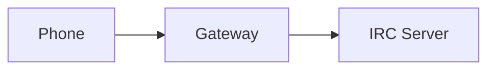

# Docs Skill

Build, maintain, and update the Chatterbox documentation site.

## When to Use

- Updating documentation after code changes
- Adding new documentation pages
- Building the docs site for deployment
- Translating docs to Spanish
- Troubleshooting docs build issues

## Documentation Stack

| Component | Tool |
|-----------|------|
| Generator | MkDocs |
| Theme | Material for MkDocs |
| Plugins | mermaid2, git-revision-date-localized, minify |
| Config | `mkdocs.yml` |
| Build | `make build` or `mkdocs build` |
| Preview | `make serve` or `mkdocs serve` |

## File Structure

```
docs/
├── index.md              # Landing page
├── getting-started.md    # Quick start guide
├── building.md           # Build instructions
├── installation.md       # Device installation
├── configuration.md      # Config options
├── gateway.md            # Gateway setup
├── usage.md              # Usage guide
├── architecture.md       # Architecture overview
├── development.md        # Dev setup & contribution
├── troubleshooting.md    # Common issues
├── security.md           # Security model
└── RUNNING.md            # Running the project

docs_es/                  # Spanish translations
├── index.md
└── getting-started.md
```

## Commands

```bash
# Preview locally (auto-reload)
make serve

# Build static site
make build

# Build with strict mode (warnings as errors)
mkdocs build --strict

# Deploy to GitHub Pages
make deploy
```

## Adding a New Page

1. Create `docs/my-new-page.md`
2. Add to `mkdocs.yml` nav:
```yaml
nav:
  - Home: index.md
  - My New Page: my-new-page.md
```
3. Preview with `make serve`
4. Build with `make build`

## Updating Existing Pages

1. Edit the relevant `docs/*.md` file
2. Preview with `make serve`
3. Check for broken links: `mkdocs build --strict`
4. Commit and push (CI will deploy)

## Documentation Style

### Format
- Use GitHub-flavored Markdown
- Headers: `#` for page title, `##` for sections, `###` for subsections
- Code blocks with language: ```java, ```python, ```bash
- Tables for structured information
- Admonitions for notes/warnings:
  ```markdown
  !!! note "Title"
      Content here

  !!! warning "Title"
      Content here
  ```

### Content Guidelines
- **Concise**: Get to the point quickly
- **Code examples**: Include working examples
- **Screenshots**: For UI features (place in `docs/assets/`)
- **Cross-link**: Link to related pages
- **Keep in sync**: Update docs when code changes

## Spanish Documentation

Spanish docs live in `docs_es/`. When adding pages:
1. Create English version in `docs/`
2. Create Spanish version in `docs_es/`
3. Keep structure parallel
4. Update `mkdocs.yml` if using a localization plugin

## Mermaid Diagrams

The docs support Mermaid diagrams:

```markdown

```

## Common Tasks

### Fix broken links
```bash
# Build with strict mode
mkdocs build --strict

# Check for broken links manually
grep -r "](.*\.md)" docs/ | while read line; do
    # Verify target exists
done
```

### Add a Mermaid diagram
1. Add ` ```mermaid ` block
2. Preview with `make serve`
3. Verify rendering

### Update the nav
1. Edit `mkdocs.yml` nav section
2. Verify all files exist
3. Preview with `make serve`

## Deployment

The docs site is deployed to GitHub Pages via GitHub Actions:
- Trigger: push to `main`
- Build: `mkdocs gh-deploy`
- URL: configured in GitHub repo settings

## Troubleshooting

### Build fails
- Check `mkdocs.yml` syntax
- Verify all referenced files exist
- Run `mkdocs build --verbose` for details

### Plugin errors
- Check `requirements-docs.txt` is installed: `pip install -r requirements-docs.txt`
- Verify plugin versions in `mkdocs.yml`

### Theme issues
- Check Material theme version
- Verify custom CSS in `docs/assets/`

## Anti-Patterns

```markdown
<!-- WRONG: Broken link -->
[Architecture](architecure.md)  <!-- Typo in filename! -->

<!-- RIGHT: Correct link -->
[Architecture](architecture.md)
```

```markdown
<!-- WRONG: Missing language tag -->
```
code block without language
```

<!-- RIGHT: Always specify language -->
```bash
make build
```
```

## Code Template: Adding a New Documentation Page

```markdown
# Page Title

Brief description of this page.

## Section 1

Content for section 1.

## Section 2

Content for section 2.

## See Also

- [Related Page](related-page.md)
- [Another Page](another-page.md)
```

## Adding to Navigation

1. Create `docs/my-page.md`
2. Add to `mkdocs.yml`:
```yaml
nav:
  - Home: index.md
  - My Page: my-page.md
```
3. Preview: `make serve`
4. Build: `make build`
